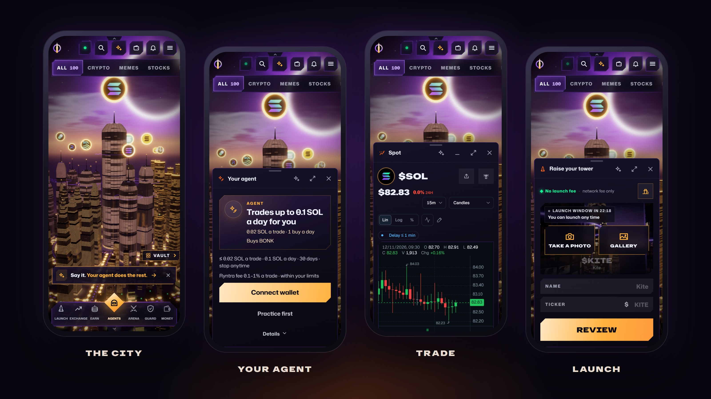

  

<h3 align="center">Your AI agent on Solana. It launches coins and trades for you — and the whole market is a living 3D city.</h3>

  <a href="https://ryntra.io"><b>ryntra.io</b></a> ·
  <a href="https://github.com/ryntra-io/ryntra-solana"><b>Source code</b></a> ·
  <a href="https://x.com/Ryntra_io"><b>@Ryntra_io</b></a> ·
  <b>Android in the Solana dApp Store</b>

---

Tell your agent *“launch me a coin”* or *“trade BONK with 0.1 SOL a day”*, sign its budget once in your own wallet,
and it does the rest: launches the coin, buys and sells inside your limits, puts idle dollars to work and reports back
every day. Every coin on Solana is a tower in the city, and yours rises live as people buy.

**Live on Solana mainnet** — your agent, launches on Meteora, trading through Jupiter, Earn and partner payouts — on
the web, on any phone and as an Android app.

## Repositories

| | |
|---|---|
| **[ryntra-solana](https://github.com/ryntra-io/ryntra-solana)** | The product: Ryntra City, the engine behind it and the Android app — the source, open to read |
| **[ryntra-solana-evidence](https://github.com/ryntra-io/ryntra-solana-evidence)** | Open-source TypeScript kit for Solana tokens: SDK, MCP server and CLI (Apache-2.0) |

## Contact

[hello@ryntra.io](mailto:hello@ryntra.io) · [@Ryntra_io on X](https://x.com/Ryntra_io)

Security reports: see the repository's `SECURITY.md`. Never send seed phrases, private keys or signing requests.

Built by **Dmytro Plavutskyi** ([@plavutskyi](https://github.com/plavutskyi)).
