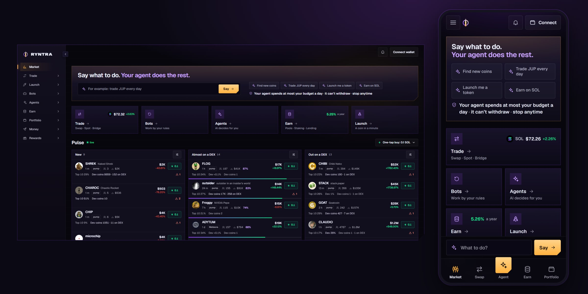

  

<h3 align="center">Say it. Your agent does the rest.</h3>

A trading terminal for Solana with your own AI agent — built on Jupiter and Meteora, Meteora DLMM Pro included.

  <a href="https://ryntra.io"><b>ryntra.io</b></a> ·
  <a href="https://github.com/ryntra-io/ryntra-solana"><b>Source code</b></a> ·
  <a href="https://github.com/ryntra-io/ryntra-solana/blob/main/METEORA.md"><b>Ryntra on Meteora</b></a> ·
  <a href="https://x.com/Ryntra_io"><b>@Ryntra_io</b></a> ·
  <b>Android in the Solana dApp Store</b>

---

Tell your agent *“trade JUP every day”*, *“copy this wallet”* or *“launch me a token”*, sign its budget once in your own
wallet, and it does the work inside limits that live on-chain: it buys by its plan and sells on its own at your stop,
the money landing only in your wallet. Swap and bridge, spot with limit orders, bots that trade on your budget — a grid,
copying a wallet — Earn on any coin's page, and launches — on the web, on any phone and as an Android app.

**Live on Solana mainnet, Meteora DLMM Pro included:** positions of many ranges in a shape you can paint, limit orders with a maker bonus, a
grid on those orders and launches straight into a pool — each signed in your own wallet.

  <picture>
    <source media="(max-width: 640px)" srcset="assets/dlmm-pro-phone.jpg">
    
  </picture>

## Repositories

| Repository | What it is |
|---|---|
| **[ryntra-solana](https://github.com/ryntra-io/ryntra-solana)** | The product: the terminal, the engine behind it and the Android app — the source, open to read |
| **[ryntra-solana-evidence](https://github.com/ryntra-io/ryntra-solana-evidence)** | Open-source TypeScript kit for Solana tokens: SDK, MCP server and CLI (Apache-2.0) |

## Contact

[hello@ryntra.io](mailto:hello@ryntra.io) · [@Ryntra_io on X](https://x.com/Ryntra_io)

Security reports: see the repository's `SECURITY.md`. Never send seed phrases, private keys or signing requests.

Built by **Dmytro Plavutskyi** ([@plavutskyi](https://github.com/plavutskyi)).
